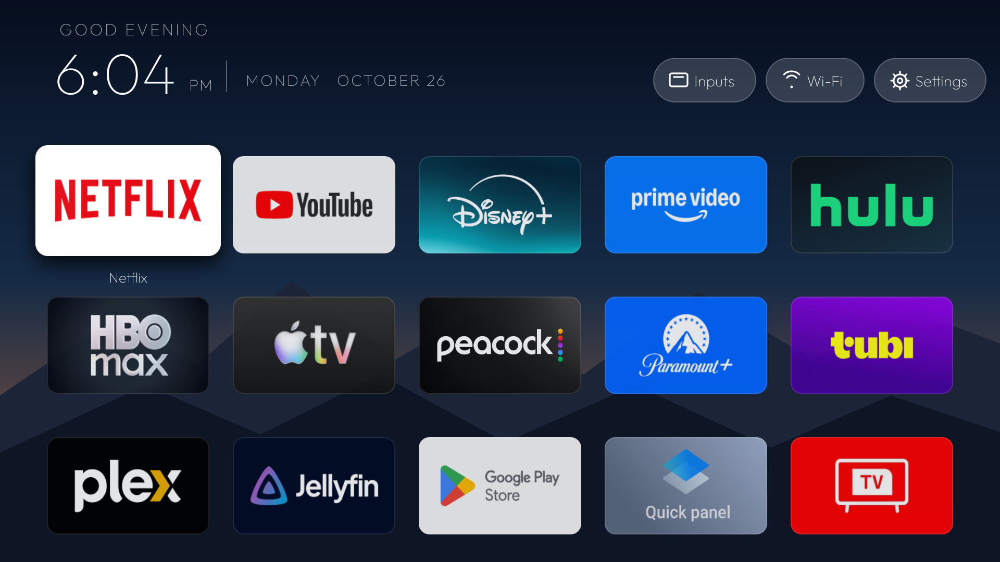
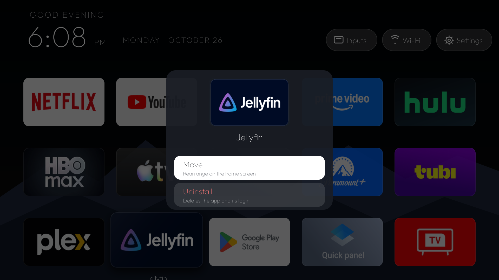
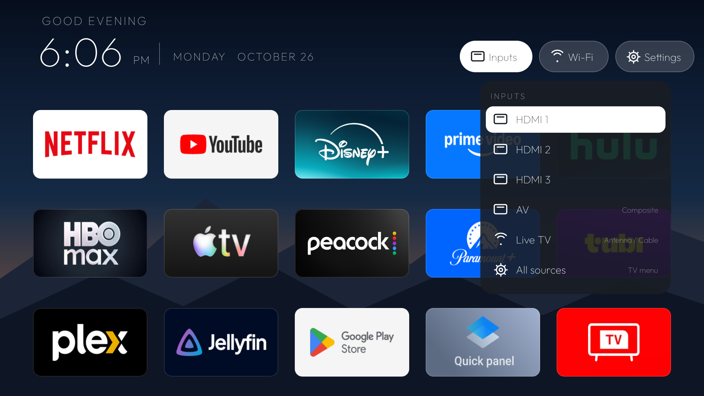
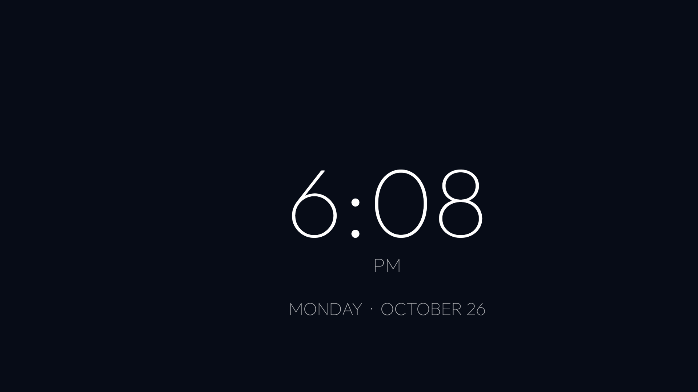

# Living Room Launcher

[](https://github.com/hunterbrewer04/living-room-launcher/actions/workflows/ci.yml)
[](https://github.com/hunterbrewer04/living-room-launcher/releases/latest)
[](#compatibility)
[](LICENSE)

A small, ad-free home screen for Google TV and Android TV, plus reversible ADB scripts to switch the stock home screen off and clear out preinstalled bloat. It works on any brand. The home screen is just the launcher, and the scripts figure out the rest per device.



| Hold OK on an app | Inputs menu | Clock screensaver |
|---|---|---|
|  |  |  |

<sub>Real screenshots from a TCL Google TV, taken over ADB.</sub>

**[Download the latest APK](https://github.com/hunterbrewer04/living-room-launcher/releases/latest)** · [What's new](CHANGELOG.md)

- **No ads, no tracking, no network.** The APK is about 115 KB, pure Kotlin with one custom `View`, and has no third-party runtime libraries. Its only permission is `REQUEST_DELETE_PACKAGES`, which opens the system "Uninstall?" dialog.
- **Clock, greeting and date header**, with a five-column app grid built from your installed TV apps. Banner art is used when an app has it. Otherwise you get the icon on a color sampled from it.
- **Hold OK on an app** to move it, or to uninstall it if you installed it yourself. The order you set persists.
- **Inputs menu** built from whatever HDMI/AV/tuner sources the TV reports. Nothing in it is hardcoded per model, and the TV's own source picker is the last entry.
- **Wi-Fi and Settings shortcuts**, and Play Store shown as **Get Apps**. New installs appear right away.
- **Built-in clock screensaver**, so the Google ambient mode can go. It drifts a little every minute so it can't burn into OLED panels.
- About 55–75 MB of RAM in use, vs about 150 MB for the stock Google TV home on the same set.

It does not touch app data. Netflix, Disney+, and everything else stays signed in. Chromecast, AirPlay, Bluetooth remotes, the Google TV / Home Assistant remote, TV inputs and the Play Store all keep working, and the scripts refuse to disable the packages behind them.

> [!WARNING]
> Disabling system packages on firmware you don't know can break things. Everything here uses `pm disable-user`, which is reversible: nothing is uninstalled and `restore.sh` undoes it. Still, go one batch at a time, and never factory-reset to "fix" something (you'd lose every login). If a TV boots into Android Recovery, choose **Try again**.

## Compatibility

| | |
|---|---|
| OS | Android TV / Google TV, Android 6.0+ (API 23). Home handover tested on Android 11 |
| Tested | Hisense Google TV (Android TV 11, MediaTek), TCL Google TV (Android TV 11, Realtek) |
| Profiles | `google` (any brand, the baseline), `hisense`, `tcl` |
| Streaming sticks | Launcher works. The Inputs menu just has fewer entries (or none) |

The launcher itself is brand-neutral. Brands differ in **which packages are safe to disable**, so that knowledge lives in `profiles/<brand>.sh`. The scripts pick the profile from the TV's `ro.product.manufacturer` and fall back to `profiles/google.sh`, which only disables Google packages that are the same on every TV. Vendor packages are never disabled unless a profile or you name them.

## 1. Turn on ADB

On the TV: **Settings → System → About**, then click **Android TV OS build** seven times. Then **Settings → System → Developer options → USB debugging** (some sets call it Network/ADB debugging). Find the TV's IP under **Settings → Network**.

```bash
adb connect 192.168.1.50
```

Accept the "Allow debugging?" prompt on the TV. On Android 11+ sets that only offer **Wireless debugging**, pair first with `adb pair IP:PORT`, then pass that `IP:PORT` as `TV`.

Every script takes the target as `TV=`, which can be an IP, `IP:port`, or a name from `devices.conf`. With one device connected you can leave it out.

```bash
# devices.conf (gitignored)
living=192.168.1.50:5555
bedroom=192.168.1.51:5555
```

## 2. Survey (read-only)

```bash
TV=bedroom scripts/survey.sh
```

This prints the model, the HOME candidates and their priority, the TV inputs, who owns the saved Wi-Fi, what each profile batch would touch, and the **review candidates**: system packages that are neither protected nor in a batch. It saves a copy under `state/<serial>/` (gitignored) so you have a baseline.

## 3. Build and install the launcher

Download the signed APK (and its `.sha256`) from [Releases](https://github.com/hunterbrewer04/living-room-launcher/releases/latest) and install it:

```bash
TV=bedroom APPLY=1 APK=~/Downloads/living-room-launcher-v0.5.3.apk scripts/install.sh
```

If the `.sha256` file sits next to the APK, `install.sh` checks it first. Or build your own (JDK 17 plus an Android SDK with platform 34; see the top of `scripts/build-release.sh` for the signing setup), which installs the newest APK in `dist/`:

```bash
scripts/build-release.sh
TV=bedroom APPLY=1 scripts/install.sh
```

> [!NOTE]
> Android only accepts updates signed with the same key. If you switch between the release APK and your own build, uninstall first. That resets your saved tile order, but nothing else.

This installs **alongside** the stock home screen. Nothing is disabled and Home isn't changed yet.

## 4. Test it side by side

Open it from the stock home screen's app row and check:

- [ ] D-pad reaches every app and header button
- [ ] Apps open and are still signed in
- [ ] Get Apps opens Google Play, and a newly installed app shows up without a reboot
- [ ] Hold OK → Move, rearrange, and the order survives leaving and coming back
- [ ] Wi-Fi and Settings open
- [ ] Every entry in Inputs switches to the right source, Live TV opens the tuner, and "All sources" opens the TV's picker
- [ ] Chromecast, AirPlay, and your remote still work
- [ ] The Home button still gets you back to the stock home screen

## 5. Hand Home over

```bash
TV=bedroom APPLY=1 scripts/activate-home.sh     # preferred Home + clock screensaver; disables nothing
TV=bedroom scripts/debloat.sh handover          # dry run: shows what it will disable
TV=bedroom APPLY=1 scripts/debloat.sh handover
TV=bedroom scripts/health-check.sh
```

Why `handover` is its own step: Android resolves Home by **intent-filter priority before** it checks the default you picked. Google's stock home (priority 2) and setup wizard (priority 1) both out-rank any third-party launcher (0), so the Home button keeps going to stock until they're disabled. The script finds everything that out-ranks us at runtime and gates on a few things first:

- Our launcher has to hold the HOME role before anything gets disabled.
- **Wi-Fi ownership is checked.** Disabling the app that saved a network deletes that network. The setup wizard often owns the one you joined during setup, and if it does, the script refuses. Forget and re-join that network in Settings, then run it again.
- Out-ranking vendor packages stop the script so a human can look at them first.

## 6. Debloat in batches

```bash
TV=bedroom scripts/debloat.sh ambient           # dry run first, always
TV=bedroom APPLY=1 scripts/debloat.sh ambient
TV=bedroom scripts/health-check.sh
```

Batches are listed per profile (`survey.sh` shows them). After each one, use the TV for a bit before moving on. To disable a single package you've researched from the review list:

```bash
TV=bedroom APPLY=1 scripts/debloat.sh extra com.vendor.something
```

Everything disabled goes into `state/<serial>/disabled-by-us.txt`. Each script refuses to touch anything matched by `PROTECT` or `PROTECT_PREFIX` in the profile: Play services, casting, the remote service, WebView, keyboards, TV settings/providers, chipset namespaces (`com.mediatek.`, `com.mstar.`, `com.realtek.`, `com.amlogic.`, ...), and each brand's own input/OTA/system stack.

## Remote app buttons (TCL and similar)

On some firmware (TCL Google TV, at least) the remote's Netflix, YouTube, Prime Video, Apple TV, gear and Input keys are vendor keycodes that only Google's stock home screen answers, so they go dead after the handover. The launcher ships an optional accessibility service, **Remote app buttons**, that catches just those keys and opens the matching app. It reads nothing on screen, and any key it doesn't know passes through untouched.

```bash
TV=bedroom APPLY=1 scripts/app-keys.sh     # same as Settings > Accessibility > Remote app buttons > On
```

> [!NOTE]
> TCL's auto-start blocker (`APP_AUTO_START` app-op) resets to "ignore" on every boot, which stops Android from binding the service. Until that's solved, re-run `scripts/app-keys.sh` after a reboot if the app buttons stop working.

## Undo, and after updates

```bash
TV=bedroom APPLY=1 scripts/restore.sh     # re-enable exactly what we disabled, give Home + screensaver back to stock
TV=bedroom APPLY=1 scripts/reapply.sh     # after a firmware update brings the stock home back
```

Every script that changes the TV prints its plan and stops unless `APPLY=1` is set. `restore.sh` keeps any package it couldn't re-enable in the ledger and exits non-zero, so you can run it again. `reapply.sh` re-checks the HOME role and Wi-Fi ownership before it disables anything.

## Adding a brand

Copy `profiles/tcl.sh` to `profiles/<manufacturer>.sh`. The filename is `ro.product.manufacturer` lowercased, so check it with `adb shell getprop ro.product.manufacturer`. Add the brand's system namespaces to `PROTECT_PREFIX`, then add batches only for packages you've disabled on a real set and lived with. PRs with tested profiles are welcome. Please note the model, the Android version, and what you checked afterward.

Machine-specific tweaks (an extra batch, a different `DISABLE_SLEEP`) go in `profiles/local.sh`, which is gitignored and sourced last.

## Layout

```
launcher/   the Android app (Gradle project): Kotlin, one Activity, one Canvas View, a DreamService
scripts/    lib.sh (shared) + survey, install, activate-home, debloat, health-check, restore, reapply, app-keys, smoke-check, build-release
profiles/   google.sh (baseline), hisense.sh, tcl.sh
state/      per-TV ledgers and surveys (gitignored)
docs/       screenshots
```

## Limits

- No cross-app "Continue Watching" row. Reading other apps' watch-next data needs a privileged permission that only the stock launcher gets.
- Screenshots often come back blank on TVs (secure video layers), so `survey.sh` reports text only.

## License

MIT, see [LICENSE](LICENSE). The bundled Outfit font is under the SIL Open Font License ([LICENSES/Outfit-OFL.txt](LICENSES/Outfit-OFL.txt)).
